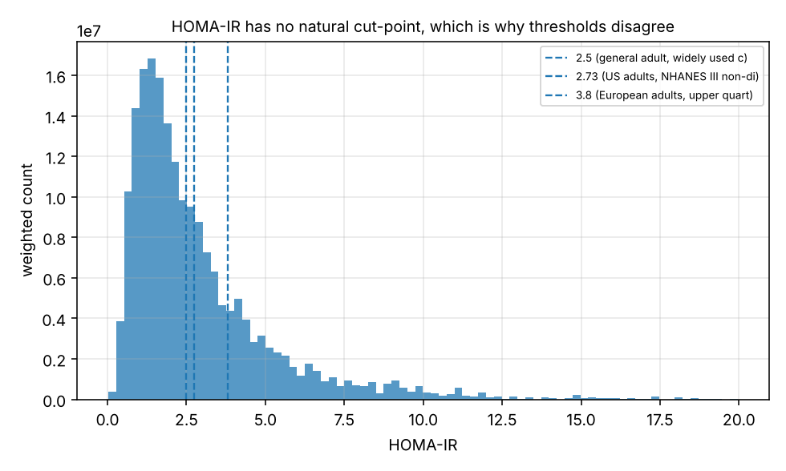

# Insulin resistance screening without an insulin assay

Estimate insulin resistance from measurements a patient already has, using
real NHANES data, and check the result against the clinical indices a
physician would otherwise use.

A gradient boosting model on age, anthropometrics, a lipid panel, fasting
glucose, HbA1c, blood pressure and ALT reaches **AUROC 0.869**, against
**0.806** for waist circumference alone and **0.744** for the
triglyceride-glucose index. The gain is statistically unambiguous, and the
model holds up on a survey wave it never saw.

**This is not a medical device and must not be used to make clinical
decisions.** It is a methods demonstration on public survey data.


---

## Why this problem is shaped the way it is

Insulin resistance precedes type 2 diabetes by years, and that window is when
intervention works. Measuring it properly needs a hyperinsulinaemic-euglycaemic
clamp: two intravenous lines and several hours. The clamp is the reference
standard and is used essentially only in research.

So practice uses HOMA-IR, which is arithmetic on a fasting blood draw:

    HOMA-IR = fasting insulin (uU/mL) * fasting glucose (mg/dL) / 405

That still needs a **fasting insulin assay**, which is expensive, is not
standardised between laboratories, and is almost never ordered in routine
care. Hence the actual question: how well can insulin resistance be estimated
*without* measuring insulin, from a panel that already exists in the chart?

That framing also sets the honesty constraint for the whole project. The label
here is derived from insulin, so a model given insulin as an input would be
inverting a formula, would score near-perfectly, and would be useless. The
test suite asserts that insulin never reaches the feature matrix.

## Results

NHANES 2013-2014, 2015-2016 and 2017-2018 pooled. 5,750 adults. Insulin
resistance defined as HOMA-IR >= 2.5, survey-weighted prevalence 42.7%.
Five-fold cross-validated, every metric survey-weighted.

| Model | AUROC | Sens @ 90% spec | Spec @ 90% sens | Brier |
|---|---:|---:|---:|---:|
| **Gradient boosting (no insulin)** | **0.869** | **0.631** | **0.621** | **0.146** |
| Waist circumference alone | 0.806 | 0.477 | 0.475 | n/a |
| BMI alone | 0.803 | 0.471 | 0.465 | n/a |
| TyG index | 0.744 | 0.351 | 0.373 | n/a |
| Fasting glucose alone | 0.743 | 0.362 | 0.349 | n/a |
| TG/HDL ratio | 0.737 | 0.331 | 0.381 | n/a |

Paired bootstrap over 1,000 resamples:

| Comparison | Delta AUROC | 95% CI | P(better) |
|---|---:|---|---:|
| model vs waist alone | +0.062 | [+0.051, +0.073] | 1.000 |
| model vs BMI alone | +0.066 | [+0.055, +0.077] | 1.000 |
| model vs TyG index | +0.125 | [+0.109, +0.141] | 1.000 |

Accuracy is not reported anywhere above, deliberately. At 42.7% prevalence a
model that answers "no" to everyone scores 57%, which tells a clinician
nothing. What matters is ranking (AUROC), a usable operating point
(sensitivity at fixed specificity), whether the number means what it says
(calibration), and whether acting on it beats the alternatives (net benefit).

### Three things in that table worth reading

#### A tape measure beats a lipid-panel index

Waist circumference alone scores
0.806 against TyG's 0.744. That ordering is not an artefact of this cohort: it
is what the literature finds too, and it is a useful thing to know before
ordering bloods. The learned model earns its place by beating waist, not by
beating a weak baseline.

#### Sensitivity is where the real gain is

The AUROC gap over waist is 0.06,
which sounds modest. At a usable operating point it is the difference between
catching 63% and 48% of resistant patients at the same 90% specificity. For a
screening test that difference is the whole point, and it is invisible in the
AUROC column.

#### It generalises to a survey wave it never saw

Training on two cycles and
testing on the third gives essentially the same number as random
cross-validation, which is the stronger claim of the two:

| Tested on | n | Model | Waist | TyG |
|---|---:|---:|---:|---:|
| 2013-2014 | 2,105 | 0.875 | 0.806 | 0.745 |
| 2015-2016 | 1,785 | 0.876 | 0.821 | 0.753 |
| 2017-2018 | 1,860 | 0.861 | 0.792 | 0.732 |
| **mean** | | **0.871** | 0.806 | 0.744 |

### Calibration and decision curve

A screening score has to mean something, not merely rank well. Predicted
against observed risk tracks closely across the whole range, with a maximum
gap of 0.042:

| Predicted | 0.03 | 0.11 | 0.30 | 0.62 | 0.87 | 0.95 |
|---|---:|---:|---:|---:|---:|---:|
| **Observed** | 0.03 | 0.14 | 0.33 | 0.58 | 0.85 | 0.94 |

Decision curve analysis answers the question a clinician actually has: is
acting on this better than treating everybody or nobody? Net benefit, higher
is better:

| Threshold probability | Model | Treat everyone | Treat nobody |
|---:|---:|---:|---:|
| 0.20 | 0.330 | 0.284 | 0 |
| 0.30 | 0.294 | 0.182 | 0 |
| 0.40 | 0.252 | 0.046 | 0 |
| 0.50 | 0.215 | -0.145 | 0 |

The model is the better strategy at every threshold, and the margin widens as
the threshold rises, which is the regime where intervention is costly enough
that you want to target it.


## Getting the survey design right

NHANES is a complex, multistage, stratified probability sample, not a simple
random sample of the United States. Three consequences, each of which silently
corrupts results when ignored.

#### The fasting subsample has its own weight

Glucose, insulin and
triglycerides are measured only in participants examined in the morning after
an overnight fast, roughly a third of the sample. That subsample carries
`WTSAF2YR`. Reaching for the general examination weight `WTMEC2YR` is the
standard mistake. Here the weighted and unweighted prevalence differ by 2.1
points (42.7% against 44.8%), and only the weighted figure describes the
population.

#### Pooled cycles need rescaled weights

CDC's guidance for combining k
two-year cycles is to divide the two-year weight by k. Skip it and the implied
population comes out three times too large.

#### The design variables matter for standard errors

`SDMVPSU` and `SDMVSTRA`
describe clustering and stratification, and people sampled from the same
cluster resemble each other, so a naive standard error is too small.

### The assay discontinuity, enforced in code

NHANES measured serum insulin on a Roche Elecsys 2010 through 2011-2012 and on
a Tosoh AIA-900 from 2013-2014 onward. From CDC's own documentation of the
237-specimen crossover study:

> The Roche insulin method arithmetic mean was 11.3% higher than the Tosoh
> method mean (16.01 vs. 14.39 uU/mL)

Pooling across that boundary without applying CDC's conversion shifts every
insulin-derived quantity, HOMA-IR included, and nothing about the resulting
cohort looks wrong. So the loader refuses:

```python
>>> load_cycles(("2011-2012", "2017-2018"))
AssayMismatchError: cycles ['2011-2012', '2017-2018'] span insulin assays
['Roche Elecsys 2010', 'Tosoh AIA-900']. CDC's crossover study found the Roche
mean 11.3% above Tosoh (16.01 vs 14.39 uU/mL), so pooling without applying
CDC's conversion biases HOMA-IR and every other insulin-derived value.
```

Each cycle carries its assay as metadata, and the default pooling is verified
by test to stay on one side of the break.

## The cohort

Every exclusion is a clinical judgement, so each is named and counted rather
than buried in a chain of boolean masks:

```
   29400  pooled NHANES participants
    8832  fasting subsample with glucose and insulin  (-20568)
    7308  adults 20+                                  (-1524)
    7237  not pregnant                                (-71)
    6171  no diagnosed diabetes                       (-1066)
    6168  not taking insulin                          (-3)
    5750  complete on required measurements           (-418)
```

Pregnancy induces insulin resistance physiologically, to divert glucose to the
fetus, so those women are not pathologically resistant. Anyone already
diagnosed does not need screening, which is what this is for. Anyone injecting
insulin has a fasting insulin that reflects their last injection rather than
their pancreas, which makes HOMA-IR meaningless rather than merely noisy.

## HOMA-IR has no natural cut-point

Published thresholds range from about 2.0 to 3.8 depending on the cohort's
ancestry, age and adiposity, because the index has no absolute scale: it is
calibrated against whatever distribution it was derived in.

| Threshold | Weighted prevalence | Derived in |
|---:|---:|---|
| 2.50 | 42.7% | general adult convention |
| 2.73 | 38.2% | US adults, NHANES III non-diabetic |
| 3.80 | 23.4% | European adults, upper quartile |

The same population is 43% or 23% resistant depending on whose cut-off you
quote. Thresholds are therefore stored with the population they came from, and
the headline threshold is a parameter rather than a constant.



## Reproducing

```bash
pip install -e ".[dev]"
```

```bash
make all
```

Downloads the three NHANES cycles (~40 MB), builds the cohort, runs the
cross-validated and temporal evaluations with the bootstrap, fits the final
model and writes `reports/`. A few minutes on a CPU. No GPU.

```bash
irisk cohort          # participant flow and weighted prevalence
irisk evaluate        # the full comparison table
pytest                # 40 tests
```

## Honest limits

- Cross-sectional, so nothing here is prediction. NHANES measures
  everything at one visit. This estimates concurrent insulin resistance; it
  says nothing about who will become resistant, which is the clinically
  valuable question and needs a cohort followed over time.
- The label is a surrogate of a surrogate. HOMA-IR is itself validated
  against the clamp with correlations around 0.6 to 0.8, so the ceiling here
  is agreement with HOMA-IR, not with insulin resistance as a clamp would
  measure it.
- US population only, and that is not a detail. Insulin resistance at a
  given BMI differs substantially by ancestry, notably being higher in South
  Asian populations at lower BMI. A model fitted on NHANES and applied in
  Pakistan would likely under-detect. Checking subgroup performance before
  using this anywhere is not optional.
- Fasting glucose is a predictor and is also in the label. It appears in
  both HOMA-IR and the feature set, which inflates performance relative to a
  model using no glucose at all. This is defensible, since fasting glucose is
  routinely available and the expensive measurement being avoided is insulin,
  but it is not a clean separation and the number should be read with that in
  mind.
- No external validation. Every number comes from NHANES. Validation on an
  independent cohort is the next thing this needs, and it has not been done.

## Layout

```
src/irisk/
  indices.py   HOMA-IR, QUICKI, TyG, TG/HDL, with explicit units
  nhanes.py    download, pooling, weight rescaling, assay guard
  cohort.py    exclusions with a counted participant flow
  model.py     gradient boosting and the clinical index baselines
  evaluate.py  weighted AUROC, operating points, calibration, net benefit
  plots.py     figures
  cli.py       `irisk <stage>`
tests/         40 tests, including the insulin-leakage guard
```

## References

- Matthews et al., *Homeostasis model assessment*, Diabetologia, 1985.
- Katz et al., *QUICKI*, J Clin Endocrinol Metab, 2000.
- Simental-Mendia et al., *The product of fasting glucose and triglycerides*,
  Metab Syndr Relat Disord, 2008.
- Vickers & Elkin, *Decision curve analysis*, Med Decis Making, 2006.
- CDC, *NHANES analytic guidelines* and the INS component documentation.

## Licence

MIT.
