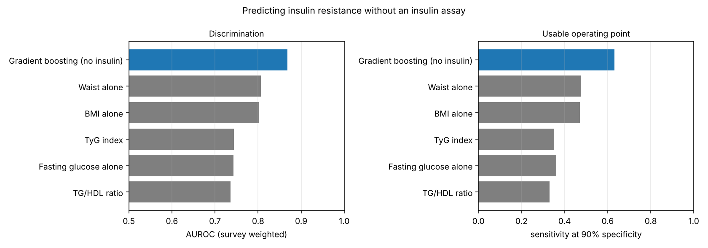
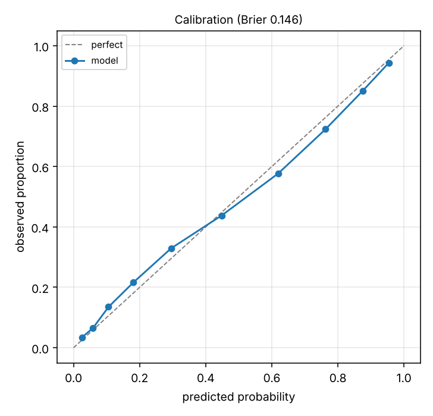

# Results

NHANES 2013-2014, 2015-2016, 2017-2018, 5750 adults. Insulin resistance defined as HOMA-IR >= 2.5, survey-weighted prevalence 42.7%.

| Model | AUROC | Sens @ 90% spec | Spec @ 90% sens | Brier |
|---|---:|---:|---:|---:|
| Gradient boosting (no insulin) | 0.869 | 0.631 | 0.621 | 0.1457 |
| Waist alone | 0.806 | 0.477 | 0.475 | n/a |
| BMI alone | 0.803 | 0.471 | 0.465 | n/a |
| TyG index | 0.744 | 0.351 | 0.373 | n/a |
| Fasting glucose alone | 0.743 | 0.362 | 0.349 | n/a |
| TG/HDL ratio | 0.737 | 0.331 | 0.381 | n/a |

## Held-out survey wave

| Tested on | n | Model | Waist | TyG |
|---|---:|---:|---:|---:|
| 2013-2014 | 2105 | 0.875 | 0.806 | 0.745 |
| 2015-2016 | 1785 | 0.876 | 0.821 | 0.753 |
| 2017-2018 | 1860 | 0.861 | 0.792 | 0.732 |

## Paired bootstrap

| Comparison | Delta AUROC | 95% CI | P(better) |
|---|---:|---|---:|
| model vs Waist alone | +0.062 | [+0.051, +0.073] | 1.000 |
| model vs TyG index | +0.125 | [+0.109, +0.141] | 1.000 |
| model vs BMI alone | +0.066 | [+0.055, +0.077] | 1.000 |

